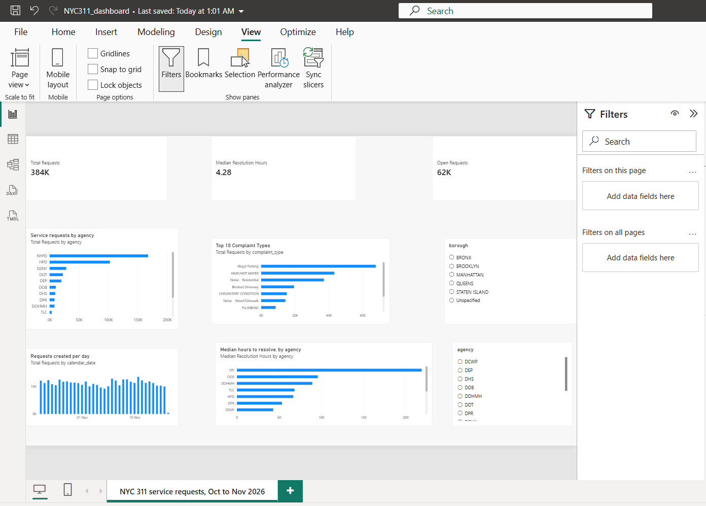
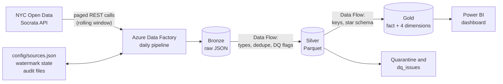
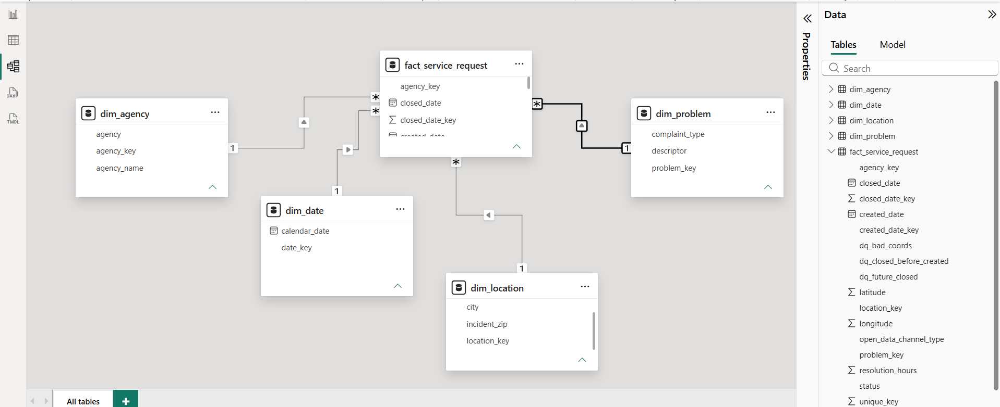

# NYC 311 Incremental Lakehouse Pipeline on Azure


An end-to-end batch pipeline on Azure that pulls a large, constantly changing public dataset (NYC 311 service requests) through an API, loads it incrementally into a bronze, silver and gold lake, and serves a star schema with a Power BI dashboard on top. Built by Meenakshi Ravi.



## At a glance

| | |
|---|---|
| **Problem** | Load a 30-day window of about 385,000 changing service requests every day without re-pulling everything or creating duplicates |
| **Stack** | Azure Data Factory, ADLS Gen2, Data Flows (Spark), Parquet, Power BI, Bicep, GitHub Actions |
| **Source** | NYC Open Data 311 Service Requests (Socrata API), 2020 to present |
| **Result** | Incremental loads that are safe to replay, data quality rules with an issue log, failure handling, and a star schema with 384,465 reconciled rows |
| **Cost** | Built entirely on the Azure free account credit |

### What it shows

- **Incremental loading that holds up.** A watermark-based rolling window keeps each run bounded, even when the source refreshes hundreds of thousands of old rows at once.
- **Re-runs are safe.** Moving the bookmark back three days and re-running pulled 159,866 rows again, and silver and gold stayed at exactly 384,465 rows.
- **Data quality is measured, not hidden.** Rules flag bad rows and log them instead of dropping them. On one silver build, 5,494 of 342,455 rows (about 1.6%) had missing or out-of-range coordinates.
- **Failures leave a record.** Each stage of the daily pipeline writes a `Failed` audit file with the step and error, and then fails the run.
- **Everything is code.** Pipelines live in Git, the infrastructure is described in Bicep, and a GitHub Actions workflow checks it on every push.

### What the data says

From the 25 Nov 2026 data (about 385,000 requests, mid-October to late November):

- NYPD and HPD account for roughly 70% of requests.
- The median request is resolved in about 4.3 hours, but a few take hundreds of hours, which is why the dashboard shows the median, not the average.
- About 62,000 requests (about 16%) have no close date.

---

## Architecture



The daily pipeline `poc_nyc311_daily` runs three pipelines in order (ingest, silver, gold). Each step starts only if the previous one succeeded, and each has a failure path.

| Layer | Container | What it holds |
|---|---|---|
| Bronze | `bronze` | Raw API pages, unchanged, by ingest date and run id. Never edited, so any bug can be replayed. |
| Silver | `silver` | Typed, deduplicated Parquet with quality flags: 49 columns, one row per request. |
| Gold | `gold` | `fact_service_request` and four dimensions (agency, problem, location, date). |
| Config | `config` | Source settings, the watermark, and one audit file per run. |



---

## Design

The full reasoning, with the evidence behind each decision, is in [`docs/design/design_decisions.md`](docs/design/design_decisions.md). The main points:

### 1. Incremental loading: a rolling window

The source dataset is not append-only: requests change status after they are created. On 3 Nov 2026, 558,980 rows had been updated since the day before, and 433,442 of them (about 78%) were older than 30 days. A plain "updated since last run" filter would pull more than half a million mostly old rows in one run.

Each run therefore pulls only rows that were **created in the last 30 days** *and* **updated after the saved watermark** (minus a 60-minute overlap), in pages of 10,000. The trade-off is deliberate: a request older than 30 days that changes later is ignored.

### 2. The watermark moves only on success

After a successful run the watermark is set to the time the run *started*, not to the newest row seen, so rows changed at the source mid-run are picked up next time. It is written only after every page has copied, so a failed run never moves it. The overlap means some rows are read twice, and silver removes the repeats.

### 3. Duplicates and replays

Silver keeps the latest version of each `unique_key`, ranked by `updated_at`. Because bronze is never edited and silver is rebuilt from it, re-running a window cannot inflate the data.

| Replay test (25 Nov 2026) | Rows |
|---|---|
| Silver before | 384,465 |
| Re-pulled from the API | 159,866 |
| Silver after | 384,465 |
| Fact table after | 384,465 |

### 4. Explicit schemas

The API returns every value as a string and omits null fields, so different rows have different columns. Schema inference would drift between runs, so silver defines its types explicitly and drops system columns.

### 5. Data quality

| Rule | Handling |
|---|---|
| Missing `unique_key` | Rejected to a quarantine folder (0 rows so far) |
| `closed_date` in the future, or before `created_date` | Set to null, original kept, row flagged |
| Latitude or longitude missing or outside NYC | Row kept and flagged |

Flagged rows are written to a separate issue log, so quality can be measured over time.

### 6. Gold: star schema

Dimension keys are `md5` hashes of the natural key, so they are the same on every rebuild and the fact table stays linked even though gold is recreated from scratch. Missing values become `UNKNOWN` before hashing, so no key is ever null. `resolution_hours` was checked by hand against real rows.

### 7. Reliability and operations

- **Retries:** the page copy and count lookup retry 3 times, 30 seconds apart, after the source API returned a 503 on one page during development. The failed run did not move the watermark, and nothing needed cleaning up.
- **Failure paths:** each stage writes a `Failed` audit file naming the step and error, then a Fail activity ends the run as failed. This was tested on the ingest stage.
- **Alerting:** an Azure Monitor alert on failed pipeline runs emails me. In testing it arrived [15] minutes after the failure, so the audit file is the immediate record and the alert is a backstop.
- **Audit trail:** one JSON file per run with the watermark used, the expected row count, the page count and the status.
- **Security:** Data Factory reaches storage through its managed identity, so no keys are stored anywhere.

### 8. Infrastructure and CI

`infra/main.bicep` defines the storage account, the four containers, the Data Factory and the role assignment. It was checked with `az deployment group what-if` but deliberately **not deployed** over the live resources. A GitHub Actions workflow builds the Bicep file and validates every JSON file on each push.

---

## Repository layout

```
adf/              Data Factory pipelines, datasets and linked services (synced from the factory)
config/           Source settings, watermark seed, sample audit files
dashboard/        Power BI measures and notes (measures.md)
docs/
  design/         design_decisions.md
  samples/        Real API responses used to make design decisions
  screenshots/    Evidence: runs, counts, failure handling, dashboard
infra/            Bicep file and parameters
.github/workflows/  Validation workflow
```

## Known limitations and next steps

- **Silver is rebuilt from all of bronze each run.** Simple and correct at this scale, but reads slow as bronze grows. Next step: read only new bronze folders and merge by `unique_key`.
- **No history on dimensions.** Slowly changing dimensions (type 2) are designed but not built.
- **`dim_date` covers only the days requests were created,** so a close date on a day with no new requests would have no dimension row.
- **The audit file lacks `rows_written` and `rows_rejected`.** Those counts are read from run diagnostics and recorded in the design doc.
- **Failure paths for silver and gold are built the same way as ingest but were tested only on ingest.**
- **The Azure resources were deleted after the free credit ended.** The exported gold files, screenshots and documentation are kept in this repository's evidence folders and the dashboard, and the code and configuration can recreate the pipeline.

## Data source and credit

Data: [NYC Open Data, 311 Service Requests](https://data.cityofnewyork.us/) (City of New York). The dataset page shows no license information, so this project is for learning and portfolio use only.